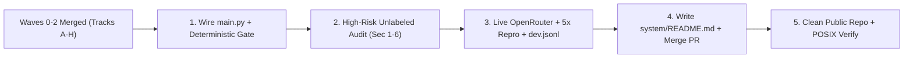

# Final Implementation & Execution Plan — FinCrime Hackathon ("Same Person or Not?")

## 1. Mandatory AI & Team Operational Directive (Git, PRs, Human-Only Merges & Hygiene)

> **Every AI agent and team member executing this plan MUST follow these rules from step one:**
>
> 1. **One task per branch, created from the latest `main`:** Never edit or commit directly on `main`. Use `chore/*` and `feat/*` branch naming:
>    ```sh
>    git checkout main && git pull origin main
>    git checkout -b feat/<track-name>
>    ```
> 2. **Simultaneous work via `git worktree` and exclusive file ownership:** In Waves 0–2, parallel tracks used separate `git worktree` checkouts with exclusive file ownership. For the solo post-Wave-2 finish, work sequentially on a single branch (`feat/final-delivery`) from `main`.
> 3. **Integration exclusively through Pull Requests (`main`):** After passing the track's acceptance checks, push the branch (`git push -u origin <branch>`) and open a Pull Request targeting `main`. State clearly: scope, files touched, commands run, observed test outputs, known limitations, and any impact on decision costs or unsafe clearances.
> 4. **UNBREAKABLE RULE — AI NEVER APPROVES OR MERGES PRs:**
>    - AI agents are **strictly forbidden** from approving, accepting, auto-merging, or merging any PR (`gh pr merge`, `gh pr review --approve`, `git merge` into `main`, or `git push origin main`).
>    - **Only a human reviews, approves, and merges PRs into `main`.** In Waves 0–2, teammates cross-reviewed/merged PRs; for the solo post-Wave-2 finish, the human owner reviews and merges their own PR into `main` (AI still never approves or merges PRs).
>    - While waiting on human review, the AI may start an independent lookahead branch in a separate `git worktree`. Once a dependency merges into `main`, rebase/update the consuming branch and re-run tests against the real merged modules.
> 5. **Data Hygiene & Clean Public Submission Repository:**
>    - Never commit `OPENROUTER_API_KEY`, `.env` files, or API response caches.
>    - Local development tests inside this working repository **may** reference verified `dev/` hit and note IDs (e.g., `H-622EDD`, `H-2C6B2E`, `NOTE-7F183D`).
>    - Because this working repository already tracks `dev/` and `screening-dev-browse.xlsx` in its Git history (and a `.gitignore` rule alone does not purge Git history), the **final public submission MUST be published in a brand-new clean repository initialized from scratch** containing **only** `system/`, `output/dev.jsonl`, and a clean root README—zero `dev/` files, zero `.xlsx`, zero dev-only fixtures referencing participant records, and zero secrets or caches.

---

## 2. Executive Summary & Locked Design Decisions

The goal is to deliver a POSIX CLI `system/run <data folder> <output file>` that resolves entity-screening alerts across Sanctions, PEP, Enforcement, Adverse Media, and SOE watchlists in strict compliance with [POLICY.md](POLICY.md), [README.md](README.md), [output.schema.json](output.schema.json), and [Aditional.md](Aditional.md).

### Locked Engineering Decisions

| Area | Final Locked Decision | Rationale |
|---|---|---|
| **1. OpenRouter API Role** *(No local models)* | **Hybrid Selective Fallback (4 free-text extraction tasks only):** Deterministic local parsers run first. When free text cannot be parsed locally, Python stdlib calls OpenRouter API for: (1) KYC/onboarding notes, (2) non-generic support/residence notes, (3) hit paragraph-1 DOB/age, and (4) category-matched `search_results` snippets. Customer graph, name/date/country normalization & matching, SOP decision rules, evidence selection, and 2–4 sentence `reason` generation stay **100% deterministic**. Offline OpenRouter use (outside `system/`) is allowed for generating synthetic paraphrase tests and auditing unlabeled hits. | Protects 100% of deterministic SOP edge cases and 5x reproducibility while handling unseen free-text wording in the 80%-weighted Unseen Set. |
| **2. Fallback Activation & Clue Safety** | **Pending-Clue Epistemic Safety + Always-On Fallback:** Track every fact as `ABSENT`, `PENDING_CLUE`, or `VERIFIED`. `PENDING_CLUE` blocks only clearances/decisions that could flip if resolved (never blocks proven independent contradictions like `DECEASED` or `ENTITY_TYPE_MISMATCH`). Whenever `OPENROUTER_API_KEY` is set, all 4 OpenRouter fallback tasks are active by default (no ablation gate blocking activation), protected by strict deterministic post-validation. Missing key / HTTP 429 / timeout / invalid JSON degrades cleanly to `PENDING_CLUE` / `unknown`. | Prevents an unparsed free-text clue from silently turning into a `-60` unsafe clearance while remaining active out of the box. |
| **3. OpenRouter Model & Guardrails** | **Pinned Model `baidu/ernie-5.5-flash-preview:free`** (env-overridable via `OPENROUTER_MODEL`). Called exclusively via OpenRouter (`https://openrouter.ai/api/v1/chat/completions`) using stdlib `urllib.request` and `OPENROUTER_API_KEY`. Pin `temperature=0`, `top_p=1`, `seed=42` (where supported), structured JSON output, disable/cap extraneous reasoning tokens if enabled, record `model_id` + `prompt_version`, use a thread-safe per-run in-memory `SHA-256` cache, `429` exponential backoff respecting `Retry-After`, `15s` request timeout, deterministic request ordering, and hard call/token/wall-clock caps (`< 30 min`). | Zero external dependencies, zero token spend on free tier, deterministic caching within runs, and explicit resilience against `:free` RPM/daily quota limits. |
| **4. `H-2C6B2E` / `H-FE02A6` & Slash Dates** | **Dual-Mode Slash Dates + P1 Key-Value vs `SR` Conflict Flag:** Parse bank dates (`bank_internal`) as `DD/MM/YYYY`; parse hit dates (`hit_provider`) using `>12` disambiguation and preserve **both** `(Y, M1, D1)` and `(Y, M2, D2)` when both parts `<= 12`. For hits containing a key-value `DOB:` line in P1 **and** an attributed `search_results` entry: parse **both**. If the customer contradicts both -> `DOB_MISMATCH`; if both agree -> agreement (`H-FE02A6`); if P1 key-value and `SR` **conflict** relative to the customer (`H-2C6B2E`) -> flag the conflict and emit **`REVIEW / INSUFFICIENT_DATA`**. | Eliminates the `-60` unsafe-clearance trap on `H-2C6B2E` (max cost `3` if mismatch) while preserving safe clearance when both sources agree it is a different person. |
| **5. Validation & Anti-Overfitting** | **Strictly Necessary Solo Gates (`tools/` Only):** Rely on existing `tools/` without authoring new standalone test frameworks: `tools/eval_dev.py --run` (`0` `validate.py` errors, `0` unsafe clearances, `record_by_link` check, escalating to brute-force linkless scan only if `none`-link alerts show misses), `tools/audit_unlabeled.py --sample 0` (high-risk Sections 1–6 only), and `tools/repro_check.py --runs 5 --hide-labels` (`5/5` identical `(hit_id, decision, reason_code)`, `PYTHONHASHSEED`, empty `cwd`, `practice_labels.jsonl` removed, `< 30 min`). Verify live OpenRouter directly on `dev/` (and run pre-built paraphrase inputs only if already executable as-is). Never treat the 50 inspected practice labels as an unseen holdout. | Cuts every non-essential test harness while keeping 100% of the gates protecting `-60` unsafe clearances, the 80% Unseen Set, and 10% Reproducibility. |
| **6. Code Layout & Module Ownership** | **Flatter Codex Layout inside `system/`:** `system/run`, `main.py`, `contracts.py`, `data.py`, `names.py`, `dates.py`, `countries.py`, `customer.py`, `customer_notes.py`, `watchlist.py`, `profile_text.py`, `decision.py`, `explain.py`, `llm_fallback.py`, `README.md`. Outside `system/`: `tests/` (Waves 0–2 suite), `tools/` (`eval_dev.py`, `repro_check.py`, `audit_unlabeled.py`), `output/dev.jsonl`; `demo/viewer.html` `(cut / optional post-submission bonus)`. Customer domain owns `customer_notes.py`; Watchlist domain owns `profile_text.py`. | Clean separation between customer and watchlist text parsing, minimal package nesting, and a lean solo endgame surface. |
| **7. UX & Creativity Deliverable** | **Cut for Solo Finish (`demo/viewer.html` Deferred):** Dropped from the required critical path because it carries `0%` weight in the automated 80/10/10 rubric; only revisit if spare time remains *after* the clean public submission repo is pushed and verified. | Protects deadline focus on mandatory deliverables (`system/`, `output/dev.jsonl`, `system/README.md`) and `-60` / reproducibility gates. |
| **8. Git/PR & Repo Hygiene** | **AGY Convention:** `chore/*` and `feat/*` branches, human-only PR merges, `dev/` IDs permitted in local dev tests, final submission published in a **brand-new clean public repository** (`system/` + `output/dev.jsonl` only). | Protects participant data privacy and ensures clean public submission. |
| **9. Language & Target Plan File** | **English -> `FINAL_PLAN.md`** | Single authoritative blueprint for the team and AI agents. |
| **10. Parallelization Target** | **Solo Execution Post-Wave-2 (1 Person + AI):** Assumes Waves 0–2 (Tracks A–H) are fully merged on `main`; remaining strictly necessary work collapses into one single sequential branch (`feat/final-delivery`) + clean repo release in Section 7. | Eliminates PR overhead, worktree juggling, and non-essential tracks for a fast 1-person finish. |

### Scoring Weights & Cost Matrix ([README.md](README.md), [validate.py](validate.py))

| Evaluation Component | Weight | Breakdown / Acceptance |
|---|---:|---|
| **Unseen Set** (~550 hits, 5 runs, differently worded free text) | **80%** | 75% decisions + 25% reasons (`reason_code`, `customer_record_id`, minimal `evidence`, factual 2–4 sentence `reason`) |
| **Development Set** (819 hits, re-run from `system/run`) | **10%** | 75% decisions + 25% reasons |
| **Reproducibility** | **10%** | Identical `(decision, reason_code)` across **all 5 runs** on the Unseen Set, scaled by Unseen score |

| Ground Truth \ Predicted | `DIFFERENT_ENTITY` | `SAME_ENTITY` | `REVIEW` |
|---|---:|---:|---:|
| **`DIFFERENT_ENTITY`** | `0` | `3` | `3` |
| **`SAME_ENTITY`** | **`60`** *(unsafe clearance)* | `0` | `2` |
| **`REVIEW`** | **`60`** *(unsafe clearance)* | `2` | `0` |

- Decision formula in [validate.py](validate.py): `100 * max(0.0, 1 - cost / baseline)`, where `baseline` is the cost of predicting `REVIEW` on every hit (`108` across the 50 `dev/practice_labels.jsonl`).
- **20:1 Asymmetry:** One unsafe clearance (`60`) destroys as much score as sending **20** false positives unnecessarily to `REVIEW` (`3`). **Zero unsafe clearances** is the #1 invariant; clearing false positives and confirming `SAME_ENTITY` come next, strictly bounded by [POLICY.md](POLICY.md).

---

## 3. Verified Forensic Baseline (`dev/` Data Findings & Policy Pitfalls)

Every figure below was verified directly against `dev/*.jsonl`, [POLICY.md](POLICY.md), [README.md](README.md), [output.schema.json](output.schema.json), and [validate.py](validate.py).

| Verified Finding in `dev/` | Engineering Consequence |
|---|---|
| **Dataset scale & distribution:** 440 alerts (395 Individual, 45 Company), 819 hits (702 Individual, 117 Company), 96 multi-hit alerts (up to 15 hits/alert), 72,265 `customers`, 86,659 `accounts`, 54,488 `kyc_checks`, 31,895 `notes`, 16,882 `search_results`, 50 `practice_labels` (28 `DIFFERENT_ENTITY`, 12 `SAME_ENTITY`, 10 `REVIEW`). | Index once per run, resolve candidate customer person(s) once per alert, emit all 819 hit decisions. An alert closes only if **every** hit is `DIFFERENT_ENTITY`. |
| **Joint accounts (`52` accounts / `58` alerts):** 52 distinct `account_id`s are joint accounts (2 holders each), and 58 of the 170 account-linked alerts point to joint accounts (6 joint accounts receive 2 alerts). | `account_id` index MUST return a list of holders; disambiguate joint holders using Principle 2 screened criteria (`name`, `dob`, `country`, `city`). |
| **Linkless alerts (`146`) & `login_name`:** Out of 440 alerts, 170 link by `account_ref`, 70 by `login_handle`, 54 by `email`, and 146 have no direct link. Of the 146: 114 have full DOB (109 ISO, 5 text e.g. `7 October 1987`), 2 year-month, 30 year-only; 146 have country, 76 have city; **34 have no literal name match** across CRM name fields. `customers.login_name` is `null` in all 72,265 rows (`preferred_name` has 16,216), and 21 linkless cases require comparing against `kyc_checks.verified_dob` when CRM `dob` is missing. | Never filter linkless lookup by exact literal name; index by normalized name tokens (`full_name`, `preferred_name`, `customers.login_name`, `accounts.login_handle`), DOB components (including approved `kyc_checks.verified_dob`), country, and city (broadening search when city is absent). Validate indexed search against brute-force reference for **100% recall**. |
| **Phone clustering & transitive closure (`116` + `7` docs):** 164 phones are shared across records (`144` across 2 records, `20` across 3 records — combining duplicates and family members). There are **116** `(phone, full_dob)` clusters (73 with differently formatted dates, 62.9%) and **68** shared phones with distinct full DOBs (families). Additionally, **7** approved `document_number`s are shared across distinct `kyc_applicant_id`s. | Build a global Union-Find over all 72,265 `record_id`s using edges `(phone_digits, full_iso_dob)` (from both `customers.phone` and `accounts.phone`) and `approved document_number` (including any approved doc number extracted from KYC notes). Ignore empty keys. Do **not** merge on phone or address alone. |
| **KYC checks (`54,488`) & check ordering (`1,684`):** 49,574 `approved`, 2,481 `rejected`, 2,433 `expired`; 8,229 `Companies registry lookup` checks (7,951 with `verified_dob`; 7,519/7,519 company customers have `dob`). In **1,684 applicants**, a `rejected`/`expired` check is newer than the latest `approved` check. | **Filter `result == "approved"` BEFORE sorting by `checked_at`/`created_at`** across all linked records and KYC notes of the resolved person. Preserve tied incompatible approved facts as a conflict rather than guessing. |
| **Notes (`31,895` total):** 22,575 KYC-channel notes (`0` rejected in `dev/`, though Unseen may contain rejected/expired onboarding notes) + 9,320 non-KYC notes. Of those 9,320: **6,253** are 6 exact boilerplate support templates (`freq >= 1,011`), and **3,067** are unique (`freq = 1`) residence/employment notes containing 4-digit years (including `NOTE-7F183D` mentioning `"international transfer"` alongside `"living and working in India"`). | Parse notes **lazily** only for `requester_email`s belonging to alert candidates. Parse all 3,067 unique residence notes properly—never discard a note solely because it mentions `"international transfer"`; verify subject and residence semantics (and route ambiguous ones to OpenRouter). |
| **Dual-mode slash dates (`13,066` vs `20+1`):** In bank tables (`customers.dob`: 6,348 first-part >12 vs 0 second-part >12; `kyc.verified_dob`: 3,561 vs 0; `kyc_notes`: 3,157 vs 0; total 11,015–13,066 depending on field mix), slash dates are 100% `DD/MM/YYYY` (plus 21,455 spelled-month dates and 1 spelled month-year). **However**, in `hits.profile_notes`, of 36 slash dates, **20 are `MM/DD/YYYY`** (e.g., `DOB: 6/20/1955`, `Active Date: 07/26/2018`) and **1 is `DD/MM/YYYY`** (`Alta: 23/11/2021`). | Use strict dual-mode date parsing (`bank_internal` = `DD/MM/YYYY`; `hit_provider` = `>12` disambiguated or **both** interpretations preserved when both parts `<= 12`). |
| **Hit DOBs, P1 prose, & `H-2C6B2E` / `H-FE02A6`:** 667 hits lack `dobs`; 118 of 152 hits with `dobs` have multiple dates; 117 company hits have 0 `dobs`. Explicit birth/age phrasing captures 33 narrative P1 hits (including `H-D6AE72`, `H-22A09C`, `H-44F5F0` — all in P1) plus `>= 17` paraphrases like `"then 37"` / `"he was 24"`. Two hits—**`H-2C6B2E`** (`A-D6F373`, customer `1955-11-19`) and **`H-FE02A6`** (`A-FB16AF`, customer `1955-06-20`)—have key-value `DOB: 6/20/1955` in P1 **AND** matching `SR-1054CF` (`{1955, 1956}`). | Preserve all valid DOB alternatives (`DateSpec`). Route unparsed P1 temporal clues to OpenRouter. Apply Decision #4 on `H-2C6B2E`/`H-FE02A6`: parse both key-value P1 and `SR`; flag `H-2C6B2E`'s internal conflict as `REVIEW / INSUFFICIENT_DATA` (`-3` max risk vs `-60` unsafe clearance). Remember administrative dates like `22.11.2011` (`H-FF3096`) are not DOBs. |
| **`search_results` queries (`list` vs `set`):** 16,882 results across 1,758 queries. Provider keys omit 1-letter initials (keeping initials misses 17 of 550 no-`dobs` individuals), yielding **702/702** coverage across 358 keys. Deduplicating words with `set` breaks **6 hits** with repeated tokens (`Abubakar, Abubakar`, `Mohamed Youssef Mohamed`, `Bin ... Bin ...`, dropping to 696/702). In 47 of 550 hits, the category phrase alone matches multiple results. | Build `search_results` lookup keys using `sorted(list)` of normalized tokens **without 1-char initials** (separate from Principle 8 `set` comparison). Attribute `SR` entries **per hit** using **both** the exact category phrase (`primary_category` or `categories[0]`) and a hit country (matching country name or demonym). |
| **Missing hit metadata, aliases, placeholders & rare codes:** **345** hits lack `primary_category` and the exact same **345** lack `countries` (258 have another country source in `nationality`/`citizenship`/`addresses`/`place_of_birth`; `categories` is never empty). 297 hits have aliases (59 single-part aliases: 33 Ind, 26 Comp). `name_variants.json` has 55 variant groups and 30 legal forms. 19 alerts use name placeholders (e.g., `KYC-9FC168` `NADEEM UNKNOWN`, `BUSTAMANTE 0000`), while `N26 Bank SE` uses a valid alphanumeric token. 6 hits are marked deceased (4 dated e.g. `H-BD709E`, 2 `deceased_date: null`: `H-A0E7C9`, `H-DCDB32`). 1 hit is `ENTITY_TYPE_MISMATCH` (`H-5EEC5A` in `A-41F2A9`). 68 company hits have 640 standard dated-report lines (`"According to ...; Month DD, YYYY:"`). | Use fallback `categories[0]`, all 5 hit country sources, non-transitive `name_variants.json`, pure Levenshtein (`0`/`1`/`2` edits for `<4`/`4..6`/`>=7` chars — **never Damerau-Levenshtein**, as transpositions in `#42`/`#44`/`#46`/`#49`/`#50` have len `>= 7` and cost 2 edits per Principle 8), protect alphanumeric tokens like `N26`, require `deceased_date != null` and `< screened_at`, and match exact English dated-report syntax with calendar validation. |
| **Policy & citation subtleties (`#41–#50`, `#26`, `match_score`):** Among the 50 practice labels, the 20 hits with `match_score=100` contain 9 `SAME_ENTITY`, 7 `DIFFERENT_ENTITY`, and 4 `REVIEW` (confirming score-100 hits + reviewing the rest costs 98 vs 108 baseline = `9.3/100`). In `REVIEW` hits matched via note country (`#41`, `#45`, `#47`, `#48`), citations include only the `NOTE-*` (not `CUS-*`), and company hit `#26` cites `CUS`, `KYC`, and `NOTE-2EF1F0`. When `name_agrees and dob_agrees` with disjoint countries, Principle 6 mandates **`REVIEW` immediately** (do not fall through to `NAME_DOB_MATCH`). | Ignore `match_score` for decisions. Implement exact SOP rule precedence (Rule 6 Location check must return `REVIEW / INSUFFICIENT_DATA` before confirmation rules if `name_agrees and dob_agrees`). Cite strictly the minimal decisive IDs (`CUS`, `KYC`, `NOTE`, `SR`), keeping `13` multi-code and `13` multi-record tolerances in mind. |

---

## 4. System Architecture ("Deterministic Policy Core + Grounded OpenRouter Fallback")

### Architecture Flow

```text
                        [<data folder>: JSONL + name_variants.json]
                                             │
                                             ▼
┌──────────────────────────────────────────────────────────────────────────────────────┐
│ 1. DATA LOADER & O(1) INDICES (system/data.py)                                       │
│    • Explicit file list, UTF-8, NEVER reads practice_labels.jsonl                    │
│    • Multi-value indices: account_id -> [holders], login_handle -> [cust],           │
│      email -> [cust], (account_id, customer_id) -> onboarding -> kyc_checks,         │
│      email -> notes, search_results by sorted(list) query (no 1-char initials)       │
│    • Linkless candidate indices (name tokens + birth year/parts across CRM + KYC)    │
└───────────────┬──────────────────────────────────────────────┬───────────────────────┘
                │                                              │
                ▼                                              ▼
┌────────────────────────────────────────────┐ ┌───────────────────────────────────────┐
│ 2A. CUSTOMER GRAPH & RESOLVER              │ │ 2B. WATCHLIST HIT EXTRACTOR           │
│     (system/customer.py, customer_notes.py)│ │     (system/watchlist.py,             │
│  • Global Union-Find (~72k record_ids):    │ │      profile_text.py)                 │
│    edge (phone_digits, full_iso_dob) +     │ │  • Countries: 5 fields, [Tag] strip,  │
│    edge approved document_number           │ │    comma/semicolon, exclude Intl/Eur  │
│  • Link follow + joint-account disambig    │ │  • Dated reports: exact English form  │
│  • Linkless search (all name/login/DOB/    │ │    "According to ...; Month DD, YYYY:"│
│    country/city fields; 100% recall check) │ │  • Deceased: only if date != null     │
│  • Lazy notes for alert candidates only    │ │  • DOB/Incorp:                        │
│  • Filter approved BEFORE latest check     │ │    - Company: hit.dobs only           │
│  • Verified > Declared; conflict retention │ │    - Individual: dobs -> P1 & SR      │
└───────────────┬────────────────────────────┘ │      (A4 P1-vs-SR conflict guard)     │
                │                              └───────────────┬───────────────────────┘
                │    If relevant free text yields PENDING_CLUE │
                └───────────────────────┬──────────────────────┘
                                        ▼
┌──────────────────────────────────────────────────────────────────────────────────────┐
│ 3. GROUNDED OPENROUTER API FALLBACK (system/llm_fallback.py)                         │
│    • Model: baidu/ernie-5.5-flash-preview:free (env OPENROUTER_MODEL), stdlib urllib │
│    • 4 narrow JSON extraction tasks ONLY (KYC note, residence note, P1 DOB, SR fact) │
│    • temp=0, top_p=1, seed=42, SHA-256 per-run cache, 429 backoff, call/token caps   │
│    • Deterministic Post-Validation Gate (verbatim quote, subject, negation, dates)   │
│    • Missing key / error / failed validation -> degrades cleanly to PENDING_CLUE     │
└───────────────────────────────────────┬──────────────────────────────────────────────┘
                                        ▼
┌──────────────────────────────────────────────────────────────────────────────────────┐
│ 4. SOP DECISION ENGINE & EXPLAINER (system/decision.py, system/explain.py)           │
│    • Evaluates each resolved CandidatePerson independently; aggregates multi-person  │
│      (unanimous -> decision + "AMBIGUOUS", divergent -> AMBIGUOUS_CUSTOMER_RECORD)   │
│    • Pending-clue clearance guard (blocks risky clearances, never blocks DECEASED /   │
│      ENTITY_TYPE_MISMATCH); null-customer independent-contradiction check            │
│    • Strict order: Type -> Deceased -> <16/Incorp -> DOB -> Verified Name ->         │
│      Location (immediate REVIEW if Name+DOB agree) -> Confirm -> REVIEW              │
│    • Minimal deduplicated sorted evidence + deterministic 2–4 sentence reason        │
│    • Per-hit exception isolation -> REVIEW + stderr (--strict re-raises in dev/CI)   │
└──────────────────────────────────────────────────────────────────────────────────────┘
```

### Repository & Module Layout

```text
FinCrimeHackathon/
├── .gitignore                        # .env, __pycache__/, *.pyc, .cache/
├── .gitattributes                    # *.py *.sh system/run text eol=lf
├── FINAL_PLAN.md                     # This plan
├── validate.py                       # Official organizer validator
├── output.schema.json                # Official JSON schema
├── output/
│   └── dev.jsonl                     # Generated predictions on dev/
├── system/
│   ├── run                           # POSIX executable (#!/usr/bin/env python3, LF, +x)
│   ├── README.md                     # Final architecture, determinism, model, cost, 3 cases
│   ├── main.py                       # CLI entry point, atomic write, error isolation (--strict)
│   ├── contracts.py                  # Frozen dataclasses, FactStatus, DateSpec, LLMFallback Protocol
│   ├── data.py                       # Stdlib JSONL loader + O(1) & inverted indices
│   ├── names.py                      # Principle 8 normalization & matching + provider query key
│   ├── dates.py                      # Dual-mode parser, partial dates, age {Y-a-1, Y-a}, comparisons
│   ├── countries.py                  # ISO-2/3, aliases, demonyms, territories, International/Europe
│   ├── customer.py                   # Union-Find, link/linkless resolution, KYC > CRM, conflicts
│   ├── customer_notes.py             # KYC & residence note parsers + pending clues + LLM hooks
│   ├── watchlist.py                  # Hit cascade (countries, reports, deceased, DOB, SR attribution)
│   ├── profile_text.py               # P1 narrative/KV DOB, dated reports, SR snippet parsers + LLM hooks
│   ├── decision.py                   # SOP Rules 1–9, pending-clue guards, multi-person AMBIGUOUS
│   ├── explain.py                    # 7-field JSONL formatter, minimal evidence, 2–4 sentence reason
│   └── llm_fallback.py               # OpenRouter stdlib client, SHA-256 cache, post-validation
├── tests/                            # Stdlib unittest suite per module & end-to-end invariants
├── tools/
│   ├── eval_dev.py                   # validate.py wrapper, evidence F1, reason_code breakdown, recall audit
│   ├── repro_check.py                # Runs system/run N=5 times with empty caches, checks 0 diffs
│   └── audit_unlabeled.py            # Risk audit across the 769 unlabeled hits in dev/
└── demo/
    └── viewer.html                   # (Cut for solo finish — optional post-submission bonus only)
```

### Frozen Shared Contracts (`system/contracts.py`)

Locking these dataclasses in Wave 0 lets Tracks B–G build and test independently from Day 1:

- **`FactStatus` (`Enum`):** `ABSENT`, `PENDING_CLUE`, `VERIFIED`.
  - Distinguish explicitly between "no information exists" (`ABSENT`), "relevant text exists that local regex could not reliably parse or LLM degraded" (`PENDING_CLUE`), and "parsed/validated fact" (`VERIFIED`).
- **`Fact` (`@dataclass(frozen=True)`):** `field: str`, `value: Any`, `raw: str`, `status: FactStatus`, `subject: str` (`"customer" | "hit" | "third_party" | "unknown"`), `source_type: str` (`"CUS" | "KYC" | "NOTE" | "SR" | "HIT" | "ALERT"`), `source_id: str`, `location: str` (e.g., `"profile_notes#p1"`, `"note_body"`), `date_str: str = ""`, `verified_state: str = ""` (`"approved" | "rejected" | "expired" | "declared" | ""`).
- **`ParsedDate` (`@dataclass(frozen=True)`):** `year: int`, `month: int | None`, `day: int | None`, `raw: str = ""`.
- **`DateSpec` (`@dataclass(frozen=True)`):** `possible_years: tuple[int, ...]`, `exact_dates: tuple[ParsedDate, ...]`, `source_id: str`, `origin: str` (`"hit_dobs" | "p1_prose" | "p1_kv" | "sr" | "crm" | "kyc" | "note"`), `raw: str = ""`, `is_ambiguous_slash: bool = False`.
- **`VerifiedIdentity` (`@dataclass(frozen=True)`):** `name: Fact | None`, `dob: Fact | None`, `doc_country: Fact | None`, `doc_number: str | None`, `checked_at: str`, `source_id: str`, `conflict_facts: tuple[Fact, ...] = ()`.
- **`CandidatePerson` (`@dataclass(frozen=True)`):** `record_ids: tuple[str, ...]`, `entity_type: str`, `verified: VerifiedIdentity | None`, `names: tuple[Fact, ...]`, `dobs: tuple[Fact, ...]`, `countries: tuple[Fact, ...]`, `pending_clues: tuple[Fact, ...] = ()`.
- **`ResolvedHit` (`@dataclass(frozen=True)`):** `hit_id: str`, `alert_id: str`, `entity_type: str`, `names: tuple[str, ...]`, `aliases: tuple[str, ...]`, `dob_specs: tuple[DateSpec, ...]`, `countries: tuple[str, ...]`, `earliest_report_date: ParsedDate | None`, `deceased_date: ParsedDate | None`, `sr_used_ids: tuple[str, ...]`, `p1_kv_sr_conflict: bool = False`, `pending_clues: tuple[Fact, ...] = ()`.
- **`HitDecision` (`@dataclass(frozen=True)`):** `hit_id: str`, `alert_id: str`, `decision: str`, `reason_code: str`, `customer_record_id: str | None`, `reason: str`, `evidence: tuple[str, ...]`.
- **`ExtractionRequest` / `ExtractionResult` & `LLMFallback` (`typing.Protocol`):** Defines the exact 4 extraction methods (`extract_kyc_note`, `extract_residence_countries`, `extract_hit_p1_dob`, `extract_sr_facts`) so customer and watchlist modules test cleanly with mock extractors while `llm_fallback.py` is developed in parallel.

### Domain-by-Domain Exact Specification

1. **Data Loader & Indices (`system/data.py`):**
   - Pure Python 3 stdlib, explicit input filenames (`customers.jsonl`, `accounts.jsonl`, `onboarding.jsonl`, `kyc_checks.jsonl`, `notes.jsonl`, `alerts.jsonl`, `hits.jsonl`, `search_results.jsonl`, `name_variants.json`). **Never** read `practice_labels.jsonl` in production code.
   - Must work regardless of current working directory (`system/run /abs/or/rel/dev /tmp/out.jsonl`).
   - Multi-value indices: `account_id -> [customer_id]`, `login_handle -> [customer_id]`, `email -> [customer_id]`, `(account_id, customer_id) -> [kyc_applicant_id]`, `kyc_applicant_id -> [kyc_check]`, `requester_email -> [note]`, `normalized_query_key -> [search_result]`, plus inverted linkless search indices (name tokens, birth year).

2. **Name Matching & Provider Query Key (`system/names.py`):**
   - **Normalization (Principle 8):** Lowercase, NFKD accent folding, strip `(parentheses)` and `[brackets]`, strip punctuation/hyphens (`Müller-Kägi` -> `muller kagi`), drop 1-letter initials, drop placeholders (`NA`, `N/A`, `TEST`, `UNKNOWN`, `XXX`, `NONE`, `NULL`, `TBD`, pure digit tokens like `0000` — **explicitly preserving** alphanumeric business tokens like `N26`). For companies, strip `company_legal_forms` from `name_variants.json`. Preserve Unicode letters cleanly.
   - **Matching (Principle 8):** Deduplicate parts into a `set`. Two parts match on: equality, direct membership in the same `name_variants.json` group (**non-transitive** — never link `yusuf` and `giuseppe` via shared `joseph`), concatenation/splitting (`Abdulsalam` <-> `Abdul` + `Salam`, consuming both words as 1 match), or **pure Levenshtein** edit distance (`0` edits if `min_len < 4`, `<= 1` if `4..6`, `<= 2` if `>= 7`; **never Damerau-Levenshtein** because Principle 8 specifies swapping two letters counts as 2 edits). Bipartite DP/matching ensures each part is used at most once. Agreement requires `>= 2` matched parts or all parts of the shorter name (with at least 1 real part). Individual customers with `< 2` real parts can neither confirm nor clear on name; a hit's 1-part alias can still match a `>= 2`-part customer.
   - **Provider Query Key (separate function):** Lowercase, NFKD, strip punctuation, remove 1-letter initials, keep tokens in a **`sorted(list)`** (do **not** deduplicate via `set`, preserving repeated tokens such as `Abubakar, Abubakar` for 702/702 `SR` coverage).

3. **Dual-Mode Dates, Ages & Temporal Impossibility (`system/dates.py`):**
   - **`bank_internal` mode:** `XX/YY/ZZZZ` parses strictly as `DD/MM/YYYY`, alongside ISO (`YYYY-MM-DD`, `YYYY-MM`, `YYYY`) and spelled-month formats (`7 October 1987`, `October 1987`).
   - **`hit_provider` mode:** `XX/YY/ZZZZ` uses `XX > 12 -> DD/MM/YYYY`, `YY > 12 -> MM/DD/YYYY`, and preserves **both** `(Y, M1, D1)` and `(Y, M2, D2)` when both parts `<= 12`.
   - **Age conversion (Principle 5):** Age `a` in reference year `Y` produces `{Y - a - 1, Y - a}`.
   - **DOB comparison:** Compare each `DateSpec` alternative separately. Contradiction occurs only when **every** valid hit alternative contradicts the customer (`|year_diff| > 1`, or same year with differing known months or differing known days). Adjacent year (`±1`) neither contradicts nor confirms. Confirmation requires exact year match and equality on all shared components (`month`, `day`).
   - **Temporal impossibility (Principle 6):** Using partial-date bounds (worst-case earliest/latest possible calendar dates so contradiction holds across **all** admissible endpoints): customer `< 16` at `earliest_report_date`, company incorporated **after** `earliest_report_date`, or `deceased_date < screened_at`.

4. **Geographic Normalization (`system/countries.py`):**
   - Strip trailing `[Tag]` markers from addresses (`"Northern Mariana Islands [PEP]"` -> `"Northern Mariana Islands"`).
   - Handle comma-separated values in `nationality`/`citizenship` (e.g., `"Belgrade, Serbia"` -> validate trailing/component country) and semicolon-separated segments in `place_of_birth` (last clean segment per entry).
   - Map ISO-2, ISO-3, variant spellings (`Cote D'Ivoire`, `Türkiye`, `Palestina`), and demonyms (`Dutch` -> `Netherlands`, `British` -> `United Kingdom`, etc.) while keeping **strict territory independence** (`Puerto Rico != United States`, `Northern Mariana Islands != United States`, `Jersey / British Virgin Islands != United Kingdom`, `Macao Special Administrative Region of China != China`).
   - Explicitly exclude `"International"` and `"Europe"`.

5. **Customer Graph & Identity Resolution (`system/customer.py`, `system/customer_notes.py`):**
   - **Global Union-Find (72,265 records):** Union records sharing `(phone_digits, full_iso_dob)` (across both `customers.phone` and `accounts.phone`, using `bank_internal` parsed full DOB) OR sharing an identical `document_number` from `kyc_checks` where `result == "approved"` (plus any approved document number extracted from KYC notes). Never connect empty keys or phone/address alone.
   - **Link & Linkless Lookup:** Follow `account_ref`, `login_handle`, or `email`; when an account is joint (multiple holders), filter using screened `name` (Principle 8), `dob` (every common component exact, across CRM + approved KYC), `country` (residence or nationality), and `city` (city or address). Without a link, search inverted indices using the same criteria (`full_name`, `preferred_name`, `customers.login_name`, `accounts.login_handle`, DOB across CRM + approved `kyc_checks.verified_dob`, country, city — widening when city is absent). Return **all** compatible person clusters.
   - **Lazy Note Parsing & Check Priority:** Traverse all `record_id`s in a resolved cluster -> `accounts` -> `onboarding` (`(account_id, customer_id)`) -> `kyc_checks`, plus `notes` matched by candidate `email`s (`system/customer_notes.py`). Filter `approved` checks/notes **before** picking the most recent (`checked_at` / `created_at`). Retain tied incompatible approved facts as a conflict. Prioritize `Verified > Declared` for legal name, DOB, and document country; retain all declared countries and all verified residence countries from non-generic notes (covering all 3,067 unique residence notes including `NOTE-7F183D` `"international transfer"` + residence). Keep declared data available for rules that permit declared evidence when verification is absent.

6. **Watchlist Profile Extraction & P1-vs-SR Guard (`system/watchlist.py`, `system/profile_text.py`):**
   - Preserve hit `names` and `aliases`. Gather hit countries from all 5 sources (`countries`, `nationality`, `citizenship`, `addresses`, `place_of_birth`).
   - Extract `deceased_date` only when present (`!= null`).
   - Extract `earliest_report_date` strictly from English lines matching `"According to ...; Month DD, YYYY: ..."` with calendar validity checks.
   - **Company DOB:** Use **only** `hits.dobs`.
   - **Individual DOB Cascade + Decision #4 Conflict Rule:** Gather `hits.dobs` if non-empty. Otherwise parse paragraph 1 (`profile_notes`) for narrative birth/age prose **and** check key-value `DOB:` blocks, and look up `search_results` using the `sorted(list)` query key, filtering results that contain **both** the exact category phrase (`primary_category`, or `categories[0]` if `primary_category` is missing: `"a sanctioned individual"`, `"a politically exposed person"`, `"the subject of enforcement action"`, `"named in adverse media"`, `"a state-owned enterprise official"`, else `"named on a watchlist"`) **and** a country linked to the hit (country name or demonym).
     - If P1 contains a key-value `DOB:` block **and** an attributed `SR` exists: evaluate both against the customer; if the customer contradicts both -> `DOB_MISMATCH`; if both agree -> agreement (`H-FE02A6`); if they conflict relative to the customer (`H-2C6B2E`: key-value `1955-06-20` contradicts customer `1955-11-19` on month while `SR-1054CF` `{1955, 1956}` agrees) -> set `p1_kv_sr_conflict = True` so the decision engine emits `REVIEW / INSUFFICIENT_DATA`.

7. **SOP Decision Engine & Explainer (`system/decision.py`, `system/explain.py`):**
   - **Per-candidate SOP evaluation in exact order:**
     1. `ENTITY_TYPE_MISMATCH` (`DIFFERENT_ENTITY`)
     2. `DECEASED` (`deceased_date < screened_at` -> `DIFFERENT_ENTITY`)
     3. `TEMPORAL_IMPOSSIBILITY` (customer `< 16` or company incorporated after `earliest_report_date` across all partial-date bounds -> `DIFFERENT_ENTITY`)
     4. Unresolved `p1_kv_sr_conflict` -> `REVIEW / INSUFFICIENT_DATA`
     5. `DOB_MISMATCH` (every admissible hit DOB alternative contradicts customer DOB, and no `PENDING_CLUE` DOB/P1/SR source could overturn it -> `DIFFERENT_ENTITY`)
     6. `NAME_MISMATCH_VERIFIED` (verified legal name agrees with none of hit names/aliases, individual customer has `>= 2` real parts, no `PENDING_CLUE` name/KYC source -> `DIFFERENT_ENTITY`)
     7. `LOCATION_MISMATCH` vs Name+DOB Exception: If `name_agrees and dob_agrees` and country sets are non-empty and disjoint -> **return `REVIEW / INSUFFICIENT_DATA` immediately** (Principle 6). Otherwise, if countries are non-empty, disjoint, and no `PENDING_CLUE` residence/KYC note exists -> `LOCATION_MISMATCH` (`DIFFERENT_ENTITY`).
     8. Confirmations (only if no unresolved contradiction/conflict): individual with `name_agrees and dob_agrees` -> `NAME_DOB_LOCATION_MATCH` (if country agrees) or `NAME_DOB_MATCH` (if country unknown); company with `name_agrees and country_agrees` -> `NAME_LOCATION_MATCH`.
     9. Fallback: `REVIEW / INSUFFICIENT_DATA`.
   - **Null customer (`0` candidates):** `customer_record_id: null`; still evaluate hit-only independent contradictions (`DECEASED` prior to screening); otherwise `REVIEW / INSUFFICIENT_DATA`.
   - **Multi-person aggregation (`> 1` candidate person):** Evaluate every candidate independently. If all yield the **same decision**, keep that decision (`customer_record_id = "AMBIGUOUS"`, choose a valid `reason_code` by documented stable priority, and merge decisive evidence across candidates if needed to support unanimity). If decisions differ, emit `REVIEW / AMBIGUOUS_CUSTOMER_RECORD` with `customer_record_id = "AMBIGUOUS"`.
   - **Explanations & Minimal Citations (`system/explain.py`):** Output all 7 fields of [output.schema.json](output.schema.json), 2–4 factual sentences citing exact values/conflicts/missing facts, and deduplicated, deterministically sorted minimal `evidence` IDs (`CUS-*`, `KYC-*`, `NOTE-*`, `SR-*`)—omitting `CUS-*` when a `NOTE-*` or `KYC-*` alone supplies the decisive fact (matching `practice_labels.jsonl` conventions).

---

## 5. OpenRouter API Fallback Design (`system/llm_fallback.py`)

No local LLMs are used anywhere. All runtime and offline AI calls go exclusively through OpenRouter.

### 5.1 Four Narrow Extraction Tasks

| Task ID | Trigger Condition (after Deterministic Parser) | Strictly Typed JSON Output |
|---|---|---|
| **`kyc_note`** | A candidate's KYC-channel note contains identity/check text that deterministic regex cannot cleanly parse into structured fields. | `{"status": "approved\|rejected\|expired\|unknown", "verified_name": str\|null, "verified_dob": str\|null, "document_country": str\|null, "document_number": str\|null, "checked_at": str\|null, "evidence_quote": str\|null}` |
| **`residence_note`** | A candidate's non-KYC note is not one of the 6 exact boilerplate templates and contains a country/demonym or location signal not conclusively matched locally. | `{"lived_countries": [{"country": str, "subject": "customer\|third_party\|unknown", "evidence_quote": str}]}` |
| **`hit_p1_dob`** | Individual hit lacks `dobs`, local P1 parser found no decisive DOB, and P1 contains numerical/temporal clues (age, birth year, event date). | `{"birth_date": str\|null, "age": int\|null, "reference_date": str\|null, "subject": "hit\|third_party\|unknown", "evidence_quote": str\|null}` |
| **`sr_facts`** | Individual hit lacks `dobs`/P1 DOB, a `search_results` snippet contains the exact category phrase + a hit country/demonym, and local regex cannot parse age/date. | `{"age": int\|null, "birth_date": str\|null, "reference_date": str\|null, "country": str\|null, "subject": "hit\|third_party\|unknown", "evidence_quote": str\|null}` |

### 5.2 Deterministic Post-Validation & Epistemic Safety (`PENDING_CLUE`)

Every OpenRouter response passes through a strict Python verification gate before entering `DecisionEngine`:
1. **Verbatim Quote Gate:** `evidence_quote` must be non-empty and exist as an exact (or whitespace-normalized) substring of the input snippet.
2. **Subject & Negation Gate:** Reject third-party attributions (e.g., `"his brother lived in Peru"`, `"spouse born 1980"`) and negated statements (`"never lived in"`, `"denied"`, `"did not verify"`).
3. **Code-Side Arithmetic & Normalization:** Never trust LLM date math. Extract literal age and reference date, validate that digits/tokens appear in `evidence_quote`, and compute `{Y - age - 1, Y - age}` and country normalization in `dates.py` / `countries.py`.
4. **Pending-Clue Protection:** If a relevant snippet fails local regex **and** OpenRouter is unavailable (`OPENROUTER_API_KEY` unset, timeout, HTTP `429` exhausted, or post-validation rejected), mark the fact as `PENDING_CLUE`. `decision.py` blocks clearances that depend on that missing dimension (preventing `-60` unsafe clearances) while still allowing independent proven contradictions (`DECEASED`, `ENTITY_TYPE_MISMATCH`, `TEMPORAL_IMPOSSIBILITY`).

### 5.3 OpenRouter Operational Guardrails (`baidu/ernie-5.5-flash-preview:free`)

- **Transport:** Python 3 stdlib `urllib.request` to `https://openrouter.ai/api/v1/chat/completions` using `OPENROUTER_API_KEY`.
- **Model Pinning:** Default `OPENROUTER_MODEL = "baidu/ernie-5.5-flash-preview:free"` (overrideable via `os.environ.get("OPENROUTER_MODEL")`).
- **Determinism & Stability:** Send `temperature=0`, `top_p=1`, `seed=42`, request JSON format, set tight `max_tokens=256`, and suppress/cap extraneous reasoning output if supported by the endpoint so JSON extraction stays compact and fast; parse JSON defensively (strip markdown fences/extraneous text before `json.loads`). Log `model_id`, `prompt_version`, call count, token count, and wall-clock duration.
- **Deduplication & Ordering:** Deduplicate identical `(task, text)` payloads and submit requests in deterministic sorted order. Cache results in a thread-safe **in-memory per-run dictionary** keyed by `SHA-256(model_id + prompt_version + task + text)` (never persisted across runs or committed to Git).
- **Free-Tier Quota & Latency Resilience:** Respect `Retry-After` headers with bounded exponential backoff on HTTP `429` / `5xx`, enforce `15s` per-call timeout, and enforce hard per-run caps (`max_calls`, `max_tokens`, and total wall-clock budget `<= 20 min` leaving huge margin under the 30-minute limit).
- **Offline AI Usage (Development Only, Outside `system/`):** No new offline generation is needed for the solo finish; if a pre-built paraphrase script/bank is already executable as-is, run it once as a live smoke check, otherwise verify OpenRouter live directly on `dev/`.

---

## 6. Verification & Delivery Checklist (Strictly Necessary Solo Scope)

### 6.1 Integration Milestones & Hard Release Gates

| Gate Type | Requirement |
|---|---|
| **Non-Blocking Integration Milestone (before rule tuning)** | Verify `customer_record_id` accuracy across all link types via `tools/eval_dev.py --run` (`record_by_link` breakdown); run an exhaustive brute-force linkless recall check only if `none`-link alerts show misses. |
| **Hard Gate 1 — Schema & Validator** | `system/run dev output/dev.jsonl` and `python validate.py --data dev --output output/dev.jsonl --score dev/practice_labels.jsonl` pass with **`0 problems`** across all 819 hits. |
| **Hard Gate 2 — Zero Unsafe Clearances** | **`0` observed unsafe clearances** across `practice_labels.jsonl` and the high-risk unlabeled audit (Sections 1–6). |
| **Hard Gate 3 — 5x Reproducibility** | `tools/repro_check.py --data dev --runs 5 --hide-labels` executes `system/run` **5 times in fresh empty-cache processes** (tested with `--no-llm` first, then with live OpenRouter API) and observes **`0` diffs** on `(hit_id, decision, reason_code)` (and verifies full JSONL stability). |
| **Hard Gate 4 — Runtime & POSIX Portability** | Executes from a separate working directory on POSIX (`LF` line endings and git mode `100755` via `git update-index --chmod=+x system/run` on Windows-built repos) with **`practice_labels.jsonl` removed** from `<data folder>`, completing well under **30 minutes** (target `< 30 s` deterministic on `dev/`). |

### 6.2 Verification Scope (Strictly Necessary Solo Pass)

1. **All 11 Reason Codes & Rare Policy Paths:** Already covered by the merged Waves 0–2 module unit tests in `tests/` (`DECEASED`, `ENTITY_TYPE_MISMATCH`, `AMBIGUOUS_CUSTOMER_RECORD`, company `TEMPORAL_IMPOSSIBILITY`).
2. **Exact Forensic Edge Cases & Boundaries:** Already covered by the merged Waves 0–2 module unit tests in `tests/` (`H-622EDD`, `H-D861DA`, `H-0181BD`, `H-6C7985`, `H-2C6B2E`/`H-FE02A6`, `H-FF3096`, `NOTE-7F183D`, `1,684` KYC check orderings, `116` phone+DOB clusters, `702/702` `SR` lookup, pure Levenshtein, non-transitive `name_variants.json`, territory independence).
3. **Minimal Solo End-to-End Verification (`tools/` Only — No New Test Suite Authoring):**
   - Do **not** spend time authoring new standalone `tests/test_integration.py`, `tests/test_invariance.py`, or new `tests/test_generalization.py` harnesses; rely directly on the existing `tools/` suite:
   - `tools/eval_dev.py --run` (`--no-llm` first, then live OpenRouter) to check `validate.py`, practice score, `0` unsafe clearances, `record_by_link`, and reason-text formatting.
   - `tools/audit_unlabeled.py --data dev --output output/dev.jsonl --sample 0` inspecting **only Sections 1–6** (decision distribution, rare clearances `DECEASED`/`ENTITY_TYPE_MISMATCH`/`TEMPORAL_IMPOSSIBILITY`, `AMBIGUOUS`, `null`-customer clearances, placeholder alerts, and `match_score=100` clearances; Section 7 random sampling skipped).
   - `tools/repro_check.py --data dev --runs 5 --hide-labels` (covers 5x determinism, `PYTHONHASHSEED`, empty `cwd`, `practice_labels.jsonl` removed, and `validate.py` = `0`).
   - Optional 1-command run of pre-built paraphrase inputs **only** if already ready to execute as-is.

### 6.3 Required Pre-Submission Checks & Deliverables

Run checks in two explicit stages (deterministic-only first, then live OpenRouter from a separate working directory):

```sh
# Stage 1: Deterministic integration, scoring, and high-risk unlabeled audit (OPENROUTER_API_KEY unset)
python tools/eval_dev.py --data dev --output output/dev.jsonl --run --verbose --paths
python tools/audit_unlabeled.py --data dev --output output/dev.jsonl --sample 0 --out audit.md

# Stage 2: Live OpenRouter + release-candidate checks from a separate working directory
/abs/path/to/system/run dev output/dev.jsonl
python validate.py --data dev --output output/dev.jsonl --score dev/practice_labels.jsonl
python tools/repro_check.py --data dev --runs 5 --hide-labels --no-llm
python tools/repro_check.py --data dev --runs 5 --hide-labels
```

- **`system/README.md` (Mandatory Deliverable):** Architecture diagram, customer resolution (Union-Find, joint accounts, KYC > CRM), watchlist resolution (cascade + `SR`), `Fact` provenance & minimal evidence, determinism controls (`temperature=0`, `seed=42`, SHA-256 cache, post-validation), OpenRouter model (`baidu/ernie-5.5-flash-preview:free`) & prompts, measured runtime/cost, and walkthroughs of 3 real cases (clear mismatch e.g. `H-D861DA` or `H-622EDD`, match `H-0181BD`, and review `H-6C7985`).
- **Cut / Deferred (`demo/viewer.html`):** Dropped from required deliverables for the solo finish (optional post-submission bonus only after the clean public submission repo is shipped and verified).
- **Clean Public Submission Repo:** Create a brand-new public GitHub repository from scratch containing **only** `system/`, `output/dev.jsonl`, and a clean root README (**zero** `dev/`, `.xlsx`, `.env`/API keys, `tests/`, `tools/`, or `demo/`). Address Windows-to-Linux hazards explicitly: enforce `LF` line endings and executable mode `100755` (`git update-index --chmod=+x system/run`), and verify on a Linux/WSL POSIX environment from an external working directory with `practice_labels.jsonl` removed (`< 30 min`, `validate.py` = `0 problems`, zero `dev/` files, zero `.xlsx`, zero `.env` or API keys in working tree or Git history).

---

## 7. Solo Finish Roadmap — 1 Person + AI (Assuming Waves 0–2 Merged)

> **Baseline Assumption & Operating Mode:**
> - **Waves 0, 1, and 2 (Tracks A, H, B, C, D, E, F, G) are assumed fully merged on `main`.**
> - **1 Person + AI Solo Finish:** Work sequentially on a **single branch (`feat/final-delivery`)** from `main`, executing only the strictly necessary steps to reach `0` validator errors, `0` unsafe clearances, `5/5` reproducibility, `system/README.md`, `output/dev.jsonl`, and the clean public submission repo.

### Sequential Flow



### Track Status Summary (Tracks A–J)

| Track | Status | Scope / Notes |
|---|---|---|
| **A, B, C, H, D, E, F, G** | **Merged on `main` (Assumed Complete)** | Core CLI, contracts, indices, normalizers, customer graph/notes, watchlist/profile text, SOP decision/explainer, OpenRouter fallback, and evaluation tools are all on `main`. |
| **`feat/final-delivery`** *(combines `I` + `I2` + audit fixes)* | **Active — Single Remaining Code/Doc Branch** | Wires `B–G` in `system/main.py`, incorporates any `-60` audit fixes, generates `output/dev.jsonl`, and writes `system/README.md`. |
| **GA** *(new test harness authoring)* | **Cut for Solo Finish** | Replaced by existing `tools/eval_dev.py`, `tools/repro_check.py`, and `tools/audit_unlabeled.py` (optional 1-command run of pre-built paraphrase inputs only if already ready as-is). |
| **J (`demo/viewer.html`)** | **Cut for Solo Finish** | `0%` automated score weight; deferred strictly to post-submission bonus if time remains after Step 5. |

### Solo 5-Step Execution Plan

| Step | Action & Commands | Exit Criteria |
|---|---|---|
| **1. Wire `system/main.py` & Deterministic Gate** | Create `feat/final-delivery` from updated `main`. Wire `data` -> `customer`/`watchlist`/`llm_fallback` -> `decision`/`explain` in `system/main.py`. With `OPENROUTER_API_KEY` **unset**, run `python tools/eval_dev.py --data dev --output output/dev.jsonl --run --verbose --paths`. Fix wiring/contract mismatches until clean. | `validate.py` = `0 problems`; `0` unsafe clearances on `practice_labels.jsonl`; acceptable `record_by_link` resolution; existing `tests/` pass. |
| **2. High-Risk Unlabeled Audit (`-60` Protection)** | Run `python tools/audit_unlabeled.py --data dev --output output/dev.jsonl --sample 0 --out audit.md`. Inspect **Sections 1–6 only** (distribution, rare clearances `DECEASED`/`ENTITY_TYPE_MISMATCH`/`TEMPORAL_IMPOSSIBILITY`, `AMBIGUOUS`, `null`-customer clearances, placeholder alerts, `match_score=100` clearances). Fix any systemic `-60` clearance bugs directly in `feat/final-delivery` and re-run `eval_dev.py --run`. | Zero suspicious unsafe clearances across Sections 1–6; `eval_dev.py --run` re-passes with `0` problems and `0` unsafe clearances. |
| **3. Live OpenRouter + 5x Repro + Final `output/dev.jsonl`** | Set `OPENROUTER_API_KEY`; run `python tools/eval_dev.py --data dev --output output/dev.jsonl --run` (record API calls/tokens and runtime `< 30 min`; run pre-built paraphrase inputs only if already 1-command executable). Run `python tools/repro_check.py --data dev --runs 5 --hide-labels --no-llm` and `python tools/repro_check.py --data dev --runs 5 --hide-labels`. Tighten LLM triggers/post-validation if `:free` causes nondeterminism or throttling, then regenerate final `output/dev.jsonl` via `system/run dev output/dev.jsonl` and confirm `validate.py` = `0 problems`. | `5/5` identical `(hit_id, decision, reason_code)` both `--no-llm` and live OpenRouter; runtime well under `30 min`; final `output/dev.jsonl` passes `validate.py` with `0 problems`. |
| **4. Write `system/README.md` & Merge Single PR** | Write `system/README.md` (architecture diagram, customer & watchlist resolution, provenance/minimal evidence, determinism controls, OpenRouter model & prompts, measured runtime/cost, and 3 real case walkthroughs: e.g. `H-D861DA`/`H-622EDD`, `H-0181BD`, `H-6C7985`). Push `feat/final-delivery`, open PR targeting `main`, and human owner reviews & merges into `main`. | `system/README.md` complete with measured metrics and 3 real cases; `feat/final-delivery` merged into `main`. |
| **5. Clean Public Submission Repo + POSIX Verification** | Initialize a brand-new public GitHub repo from scratch containing **only** `system/`, `output/dev.jsonl`, and a clean root README (**zero** `dev/`, `.xlsx`, `.env`/API keys, `tests/`, `tools/`, or `demo/`). Enforce `LF` line endings and executable mode `100755` (`git update-index --chmod=+x system/run`). On Linux/WSL from a separate working directory against data with `practice_labels.jsonl` removed, run `/abs/path/to/system/run <no-labels-data> /tmp/out.jsonl` and `validate.py`. | `system/run` executes `< 30 min` on POSIX; `validate.py` = `0 problems`; zero `dev/` files, `.xlsx`, or secrets in working tree or Git history. |

### Explicitly Cut for Solo Finish

- **`demo/viewer.html` (Track J):** `0%` weight in the automated 80/10/10 rubric; post-submission bonus only after Step 5 is pushed and verified.
- **Authoring new standalone test suites (`tests/test_integration.py`, `tests/test_invariance.py`, new `tests/test_generalization.py` framework):** Replaced by existing `tools/eval_dev.py`, `tools/repro_check.py`, and `tools/audit_unlabeled.py`.
- **`audit_unlabeled.py` Section 7 stratified random sample:** Use `--sample 0` (Sections 1–6 high-risk clearances only).
- **Exhaustive brute-force linkless recall harness:** Skip unless `eval_dev.py`'s `record_by_link` output shows misses on `none`-link alerts.
- **Multi-branch / multi-worktree PR splitting after Wave 2:** All remaining work lands on one single branch (`feat/final-delivery`).

### Emergency Cutoff Priority Order (Strict Descending Impact)

If time gets even tighter, follow Steps 1–5 in strict order without skipping safety gates:
1. **Step 1 — Wire `system/main.py` + Deterministic Gate:** `validate.py` = `0 problems` and `0` unsafe clearances on `practice_labels.jsonl`.
2. **Step 2 — High-Risk Unlabeled Audit (`--sample 0`, Sections 1–6):** Eliminate `-60` unsafe-clearance bugs on rare codes, `null`-customer hits, placeholders, and `match_score=100`.
3. **Step 3 — Live OpenRouter + 5x `repro_check.py --hide-labels` + Final `output/dev.jsonl`:** Lock in 10% Reproducibility and 80% Unseen-Set stability.
4. **Step 4 — `system/README.md` + Single PR Merge:** Complete mandatory architecture & 3-case documentation.
5. **Step 5 — Clean Public Submission Repo + Linux/WSL POSIX Check:** Ship compliant repo (`system/`, `output/dev.jsonl`, root README; `LF` + `100755`, zero `dev/` files or secrets).
